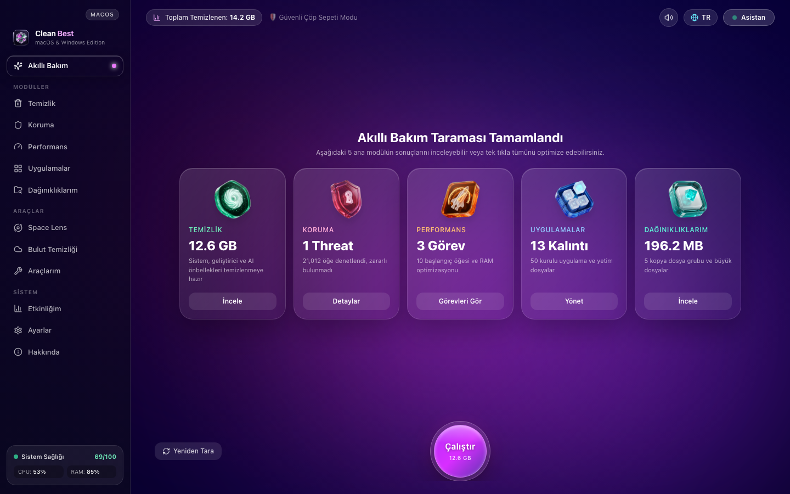
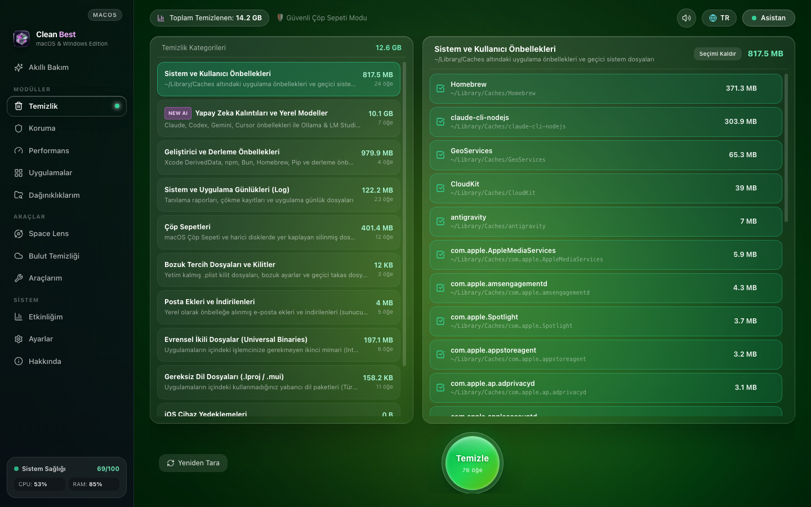
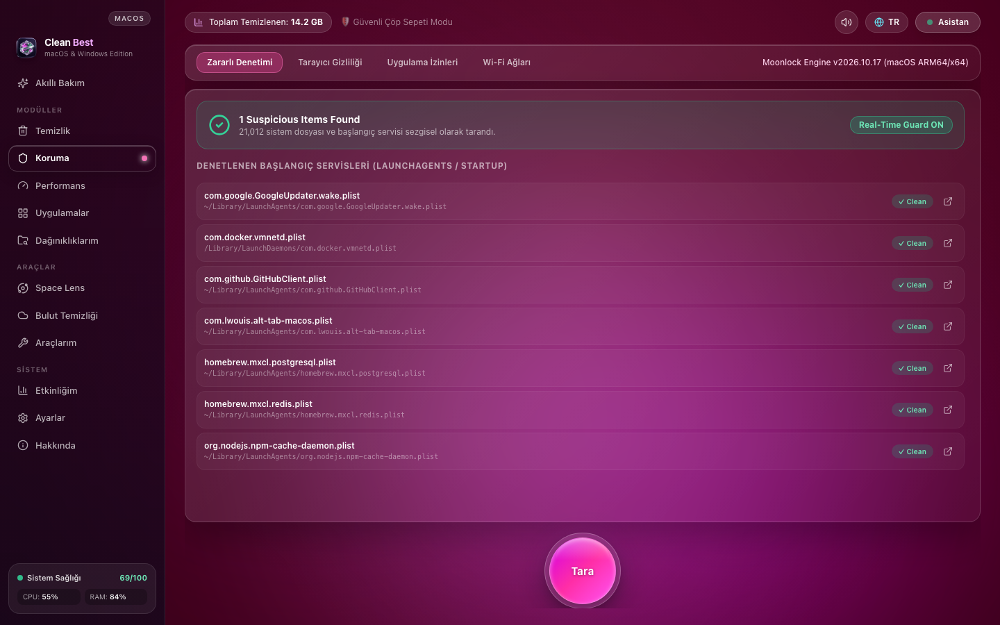
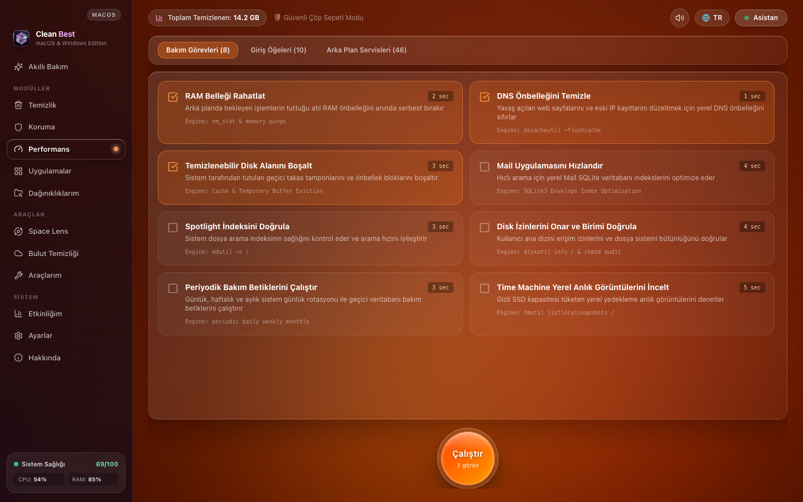
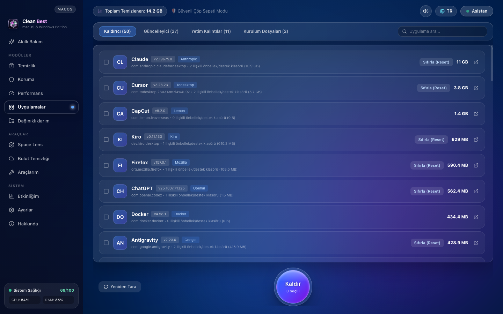
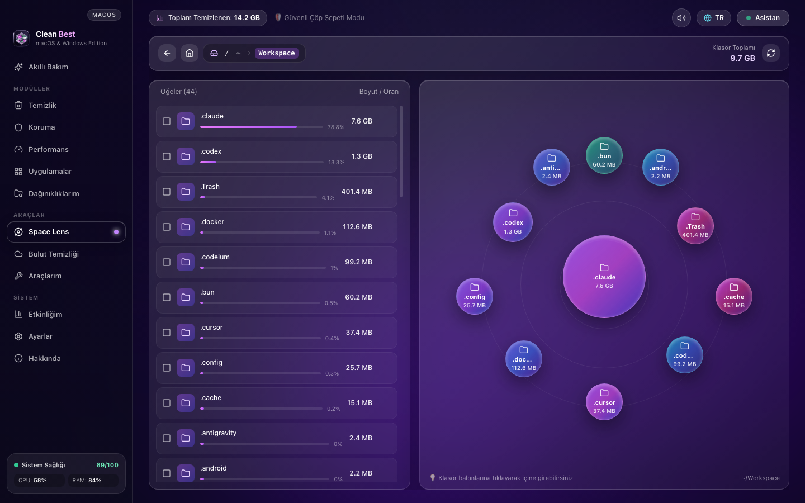
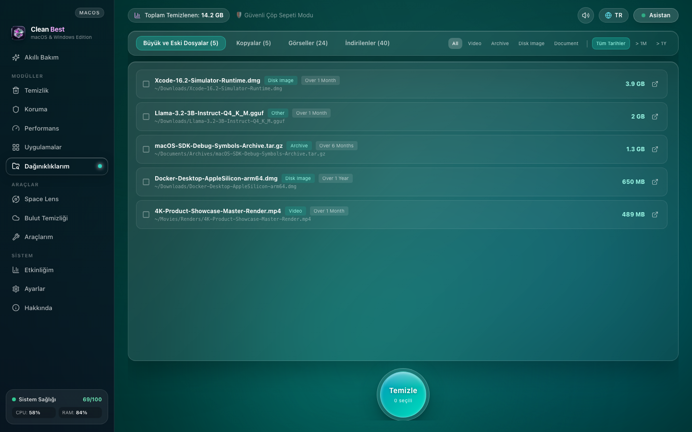
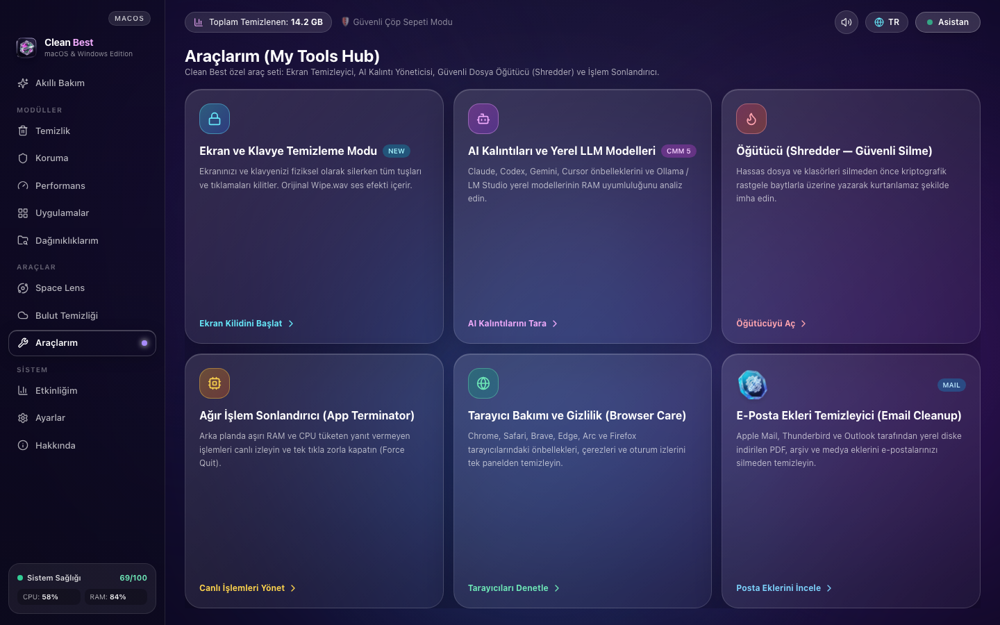
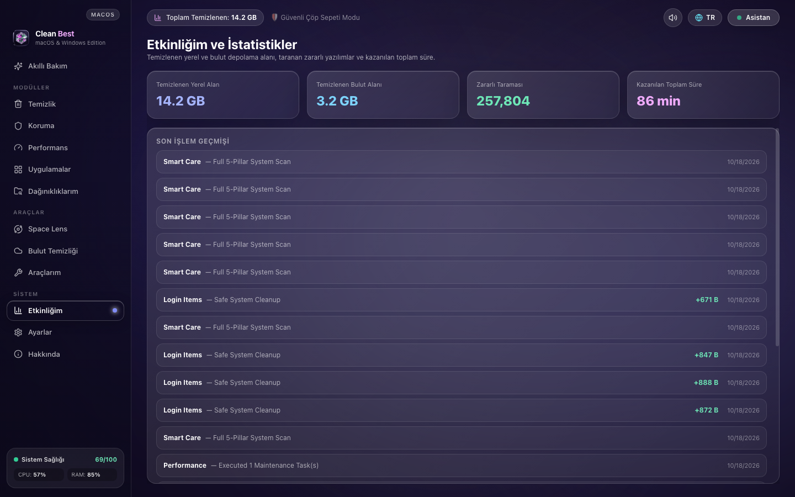

<div align="center">


# Clean Best

### Open-Source System Care, Performance Optimization & Computer Cleanup Suite for macOS and Windows

[](LICENSE)
[](#cross-platform-native-engine-matrix)
[](#installation--quick-start)
[](#project-structure)
[-06b6d4.svg?style=flat-square)](#security--deletion-safety-architecture)

<p align="center">
  <strong>100% Free Forever • Safe Trash Protection • Zero External Telemetry • Fully Auditable MIT Source Code</strong>
</p>

<p align="center">
  <a href="#visual-tour--screenshots">Screenshots</a> •
  <a href="#complete-11-module-feature-matrix">Modules</a> •
  <a href="#local-ai--llm-clutter-inspector">AI & LLM Cleaner</a> •
  <a href="#installation--quick-start">Quick Start</a> •
  <a href="#cross-platform-native-engine-matrix">OS Architecture</a> •
  <a href="#local-system-engine-api-reference">API Reference</a> •
  <a href="LICENSE">License</a>
</p>

<br />



</div>

---

## Overview

**Clean Best** is a full-featured, native desktop system cleaner, performance optimizer, privacy & security checker, and visual disk mapper built for **macOS (Apple Silicon & Intel)** and **Windows 10/11**.

Because system utilities work directly with your filesystem, startup items, browser caches, and running processes, transparency and safety matter. **Clean Best** runs 100% locally on your computer with zero telemetry and is released as **100% free and open-source software under the MIT License**.

### Key Highlights

- **12 Complete Desktop Views:** Smart Care, System & AI Junk Cleanup, Protection & Privacy, Performance & Maintenance, Complete Uninstaller & App Reset, My Clutter (SHA-256 Duplicates), Space Lens (Interactive Radial Bubble Map), Cloud Cleanup, My Tools Hub, Live Health Monitor Drawer + Native Menu Bar Tray, Activity Audit Log, and About / Settings.
- **Built for the Local AI Era:** Automatically detects, measures, and cleans caches and orphaned model weights from **Claude Desktop, Cursor, Windsurf, OpenAI Codex, Antigravity, Ollama, LM Studio, and HuggingFace Hub**, complete with real-time **RAM/VRAM hardware fit analysis** for `.gguf` and `.safetensors` models.
- **Safety-First Deletion Architecture:** Defaults to **Safe Trash Mode** (moving files to your OS Trash / Recycle Bin for effortless recovery) while also offering a dedicated **3-Pass DoD Cryptographic Shredder** (`crypto.randomBytes`, `0x00`, `0xFF` + `fsync`) when permanent destruction is required.
- **Real OS Kernel & CLI Execution:** Zero fake progress bars. Directly invokes native OS utilities (`vm_stat`, `dscacheutil`, `mdutil`, `tmutil`, `ioreg`, `lipo`, `LaunchAgents` on macOS; `PowerShell`, `ipconfig /flushdns`, `netsh wlan`, `CimInstance`, `Registry Run` on Windows).
- **Bilingual Interface & Bespoke 3D Glass Artwork:** Instant one-click switching between **English (`EN`)** and **Turkish (`TR`)**, paired with custom-rendered 3D refractive glass icons and state-driven audio cues (`ScanStarted`, `CleanupCompleted`, `Wipe`, `Alert`).

---

## Visual Tour & Screenshots

### 1. Smart Care (5-Pillar Parallel Scan) & System/AI Junk Cleanup
| Smart Care (5-Pillar Scan) | System & AI Junk Cleanup (11 Categories) |
| :---: | :---: |
|  |  |

### 2. Moonlock Protection Suite & Native Performance Tasks
| Moonlock Protection & LaunchAgents Audit | Performance & 8 Kernel Maintenance Tasks |
| :---: | :---: |
|  |  |

### 3. Complete Application Uninstaller & Space Lens Visual Storage Map
| Uninstaller, App Reset & Orphaned Leftovers | Space Lens Interactive Radial Bubble Map |
| :---: | :---: |
|  |  |

### 4. My Clutter (SHA-256 Duplicates) & My Tools Hub (6 Power Utilities)
| Large/Old Files & True SHA-256 Duplicates | My Tools Hub (Screen Lock, AI Inspector, 3-Pass Shredder) |
| :---: | :---: |
|  |  |

### 5. Live System Health Monitor Drawer & Transparent Activity Log
| Slide-Over Assistant, Speedtest & Peripheral Battery | Lifetime Telemetry & Local Activity Audit Log |
| :---: | :---: |
|  |  |

---

## Complete 11-Module Feature Matrix

### 1. Smart Care (`SmartCare`)
Runs five parallel native inspection workers in a single pass:
1. **System & AI Junk Scan**
2. **Moonlock Heuristic Malware & Persistence Scan**
3. **Performance & Maintenance Task Evaluation**
4. **Downloads & Storage Clutter Scan**
5. **Application Updates & Orphaned Leftovers Check**

Users can click into any of the 5 result cards to inspect, select, or deselect individual files before executing a unified one-click cleanup and optimization pass.

---

### 2. System & AI Junk Cleanup (`Cleanup`)
Scans **11 specialized categories** modeled on native OS internals and modern developer workflows:
1. **User & System Caches:** `~/Library/Caches` (macOS) and `%LOCALAPPDATA%\Temp` / `C:\Windows\Temp` (Windows).
2. **AI Junk & Local LLM Models:** Claude Desktop, Cursor, Windsurf, Codex, Gemini/Antigravity caches, plus Ollama (`~/.ollama/models`) and HuggingFace (`~/.cache/huggingface`) blobs.
3. **Developer & Build Caches:** `Xcode/DerivedData`, `CoreSimulator`, `npm`, `bun`, `pip`, `cargo`, `gradle`, and `Homebrew` caches.
4. **System & Crash Logs:** Diagnostic reports, `.crash` / `.ips` dumps, and rotated application logs.
5. **System Trash Bins:** Aggregated items across primary and external volume Trash / Recycle Bins.
6. **Broken Preferences & Lockfiles:** Zero-byte or corrupted `.plist` files, stale `.lock` files, and `.DS_Store` / `Thumbs.db` clutter.
7. **Mail Attachments & Local Cache:** Locally cached PDF, archive, and media attachments inside Apple Mail (`~/Library/Mail/V10`), Thunderbird, and Outlook without touching server emails.
8. **Universal Binaries (macOS Fat Binaries):** Detects applications inside `/Applications` containing redundant dual `x86_64` + `arm64` Mach-O slices and estimates reclaimable architecture space.
9. **Unused Language Files (`.lproj` / `.mui`):** Identifies unused localization resource bundles inside installed application packages while preserving English and Turkish resources.
10. **iOS Device Backups:** Audits legacy iPhone/iPad backups stored in `~/Library/Application Support/MobileSync/Backup`.
11. **Document Versions & Deleted Users:** Scans intermediate document autosave revisions (`~/Library/Autosave Information`) and remnants of deleted user accounts (`/Users/Deleted Users`).

---

### 3. Protection & Privacy (`Protection` — Moonlock Engine)
Divided into **4 specialized security tabs**:
- **Malware & Persistence Audit:** Heuristically inspects user and system `LaunchAgents`, `LaunchDaemons` (and Windows `CurrentVersion\Run` registry keys) alongside suspicious unsigned executables in temporary directories.
- **Browser Privacy & Tracking Data:** Audits and cleans local caches, session data, and cookie stores across **Google Chrome, Apple Safari, Brave, Microsoft Edge, Arc, and Mozilla Firefox**.
- **Application Permissions (TCC Audit):** Lists applications with sensitive hardware/privacy entitlements (Camera, Microphone, Screen Recording, Full Disk Access) and opens direct OS permission management.
- **Wi-Fi Network Security:** Inspects the active wireless interface (`airport` / `system_profiler SPAirPortDataType` / `netsh wlan`), reporting SSID, BSSID, channel, RSSI signal quality, and encryption safety (WPA2/WPA3 vs. insecure open networks).

---

### 4. Performance & Kernel Maintenance (`Performance`)
Executes **8 real OS maintenance routines** plus interactive startup management:
1. **Free Up Compressible RAM:** Triggers `vm_stat` pressure analysis and native memory buffer eviction.
2. **Flush DNS Cache:** Executes `dscacheutil -flushcache` & `killall -HUP mDNSResponder` (macOS) or `ipconfig /flushdns` (Windows).
3. **Purgeable Disk Space Eviction:** Releases temporary swap buffers and OS purgeable cache blocks.
4. **Speed Up Mail SQLite Indexes:** Vacuum-optimizes local Mail `Envelope Index` SQLite databases.
5. **Verify Spotlight / Search Index:** Queries `mdutil -s /` status to validate search indexing health.
6. **Repair Home Permissions & Verify Volume:** Audits home directory ACLs and checks root volume integrity via `diskutil info /`.
7. **Run Periodic Maintenance Scripts:** Executes daily, weekly, and monthly log and temporary database maintenance routines.
8. **Thin Time Machine Local Snapshots:** Audits local APFS snapshots via `tmutil listlocalsnapshots /`.
- **Login Items & Background Launch Agents Tabs:** Inspects and removes unneeded startup items and background plist services.

---

### 5. Applications (`Applications`)
A 4-tab application lifecycle manager:
- **Complete Uninstaller:** Scans `/Applications`, `~/Applications`, and Windows Program directories, automatically correlating every app's `CFBundleIdentifier` with its hidden folders in `~/Library/Application Support`, `~/Library/Caches`, `~/Library/Preferences`, `~/Library/Saved Application State`, and `~/Library/Containers`.
- **One-Click App Reset:** Resets a misbehaving application back to factory defaults by purging its support caches and preference files while keeping the `.app` binary untouched.
- **Updater:** Checks installed applications and Homebrew casks/formulae (`brew outdated --json`) for available version updates.
- **Orphaned Leftovers:** Detects `Application Support` and `Cache` folders left behind by applications that were previously dragged to the Trash without a proper uninstaller.
- **Installers:** Finds forgotten `.dmg`, `.pkg`, `.iso`, `.msi`, and `.exe` setup packages across `Downloads` and `Desktop`.

---

### 6. My Clutter (`MyClutter`)
- **Large & Old Files:** Scans user directories for space-hogging files with instant filtering by file type (`Video`, `Archive`, `Disk Image`, `Document`) and last-opened age (`All Dates`, `Over 1 Month`, `Over 1 Year`).
- **True SHA-256 Duplicates:** Pre-groups files by exact byte size and computes cryptographic `SHA-256` digests (`crypto.createHash('sha256')`) to guarantee 100% byte-identical duplicate detection regardless of filename.
- **Similar Images & Screenshots:** Groups screenshots, burst photos, and high-resolution media files.
- **Downloads Inspector:** Dedicated view to audit and bulk-clean accumulated files in `~/Downloads`.

---

### 7. Space Lens (`SpaceLens`)
- **Interactive Radial Bubble Storage Map:** Visualizes any directory on your drive as a spatial solar system where the largest subdirectory sits at the center surrounded by size-proportional satellite bubbles.
- **Instant Drill-Down & Breadcrumb Navigation:** Click any folder bubble or list row to traverse deeper into subdirectories, jump back via interactive breadcrumbs, reveal items in Finder/Explorer, or select and clean items directly inside Space Lens.

---

### 8. Cloud Cleanup (`CloudCleanup`)
- Automatically discovers local sync folders for **iCloud Drive** (`~/Library/Mobile Documents/com~apple~CloudDocs`), **Google Drive**, **Microsoft OneDrive**, and **Dropbox**.
- Highlights large locally cached files consuming both SSD space and cloud quota so you can clean or evict them safely.

---

### 9. My Tools Hub (`MyTools`)
Six specialized engineering utilities accessible from a single launchpad:
1. **Screen & Keyboard Cleaning Mode:** Fullscreen translucent lock overlay with a 30-second countdown timer and authentic `Wipe.wav` sound effect that intercepts keyboard and mouse clicks while you physically wipe your display and keyboard.
2. **Local AI & LLM RAM Fit Inspector:** Scans local `.gguf` and `.safetensors` models across Ollama, LM Studio, and HuggingFace and calculates whether each model fits your system's physical RAM (`Optimal Fit`, `Heavy Load`, or `Insufficient RAM`).
3. **3-Pass Cryptographic Shredder:** Overwrites sensitive files or directories 3 times (`Pass 1: crypto.randomBytes`, `Pass 2: 0x00`, `Pass 3: 0xFF` + `fsync`) before unlinking so forensic recovery tools cannot reconstruct them.
4. **Heavy Process Terminator (App Terminator):** Live process monitor sorting background apps by real-time RAM (MB) and CPU (%) consumption with one-click `SIGTERM` / `taskkill` termination.
5. **Browser Care & Privacy Shortcut:** Direct jump into multi-browser cache and session cleanup.
6. **Email Attachment Cleaner Shortcut:** Direct jump into local Mail attachment cache cleanup.

---

### 10. Live Health Monitor Drawer & Native System Tray (`HealthMonitor`)
- **Native macOS Menu Bar & Windows System Tray:** Lives in the system tray even when the main window is closed, displaying live CPU, RAM, and Disk health scores with quick actions (`Run Smart Care`, `Free Up RAM`, `Flush DNS`).
- **Slide-Over Assistant Drawer:**
  - Real-time **RAM + Swap** usage gauge with one-click **Free Up RAM** button.
  - Real-time **CPU Load (%)**, core count, and thermal sensor estimation.
  - **Primary Disk** free space and reclaimable junk indicator.
  - **Live Network Traffic (KB/s)** + integrated **Cloudflare CDN Speedtest** measuring real Download Mbps, Upload Mbps, and Ping latency (ms).
  - **Battery & Bluetooth Peripheral Telemetry:** Queries `ioreg` / `pmset` to display battery percentages for your MacBook/laptop battery alongside connected Bluetooth Magic Keyboard, Magic Trackpad, Mouse, and headphones.

---

### 11. My Activity & Settings (`Activity` & `Settings`)
- **Transparent Local Audit Log:** Persists lifetime statistics (`Total Space Cleaned`, `Cloud Space Recovered`, `Threats Audited`, `Time Saved`) and a chronological history of every scan and cleanup in `~/.compcleaner-activity.json`.
- **Configurable Deletion Mode & Ignore List:** Toggle between **Safe Trash Mode (Default)** and **Permanent Deletion Mode**, configure Moonlock real-time protection toggles, manage custom excluded paths in the **Ignore List**, enable/disable 3D audio effects, and switch UI languages (`EN` / `TR`).

---

## Local AI & LLM Clutter Inspector

Modern AI IDEs and local LLM runners silently consume tens of gigabytes of SSD space. **Clean Best** treats AI clutter as a first-class citizen:

| AI Tool / Runtime | Inspected Paths | What Clean Best Detects & Cleans |
| :--- | :--- | :--- |
| **Ollama** | `~/.ollama/models/blobs` | Orphaned or unused GGUF model blobs + RAM compatibility rating |
| **LM Studio** | `~/.cache/lm-studio/models` | Downloaded quantized `.gguf` weights + memory pressure check |
| **HuggingFace Hub** | `~/.cache/huggingface/hub` | Cached `.safetensors`, `.bin` checkpoints, and dataset snapshots |
| **Claude Desktop** | `~/Library/Caches/com.anthropic.claudefordesktop*`, `~/.claude` | ShipIt updater payloads, GPUCache, and CLI node caches |
| **Cursor & Windsurf** | `~/Library/Application Support/Cursor/Cache`, `~/.cursor` | Cached VSIX extensions, GPU shader caches, and logs |
| **OpenAI Codex & Antigravity** | `~/.codex`, `~/.gemini/antigravity` | Temporary workspace caches and stale browser/runtime logs |

---

## Cross-Platform Native Engine Matrix

The backend engine ([`server/systemEngine.ts`](server/systemEngine.ts)) automatically detects `process.platform` (`darwin` vs `win32`) and executes authentic OS commands:

| Subsystem | macOS (`darwin` — ARM64 & Intel) | Windows (`win32` — x64 & ARM64) |
| :--- | :--- | :--- |
| **RAM & Swap Telemetry** | `vm_stat`, `sysctl vm.swapusage` | `os.freemem()`, `Get-CimInstance Win32_OperatingSystem` |
| **Disk Usage & Volumes** | `df -k /`, `diskutil info /`, `/Volumes` | `fs.statfsSync('C:\\')`, `Get-CimInstance Win32_LogicalDisk` |
| **DNS Cache Flush** | `dscacheutil -flushcache`, `killall -HUP mDNSResponder` | `ipconfig /flushdns` |
| **Startup & Persistence** | `~/Library/LaunchAgents`, `/Library/LaunchAgents`, `/Library/LaunchDaemons` | `HKCU\...\CurrentVersion\Run`, `HKLM\...\Run`, Startup Folder |
| **Wi-Fi Security Audit** | `networksetup -getairportnetwork en0`, `system_profiler SPAirPortDataType` | `netsh wlan show interfaces` |
| **Battery & Peripherals** | `pmset -g batt`, `ioreg -r -k "BatteryPercent"` | `Get-CimInstance Win32_Battery` |
| **Safe Trash Mode** | Moves items safely to `~/.Trash` with collision-safe timestamps | Moves items safely to user Recycle/Trash folder |
| **3-Pass File Shredder** | `crypto.randomBytes` + `0x00` + `0xFF` + `fs.fsyncSync` | `crypto.randomBytes` + `0x00` + `0xFF` + `fs.fsyncSync` |

---

## Installation & Quick Start

### Prerequisites
- **Node.js** `v20.0.0` or newer (`v22+` / `v24+` recommended)
- **npm** `v9+`
- **OS:** macOS 12 Monterey or newer (Apple Silicon M1–M4 or Intel) / Windows 10 or Windows 11

### 1. Clone the Repository & Install Dependencies

```bash
git clone https://github.com/schevko/clean-best.git
cd clean-best
npm install
```

### 2. Launch the Native Desktop Application (Electron)

```bash
npm run desktop
```

This command builds the frontend assets and launches the native **Electron** desktop window along with the embedded local system engine (`127.0.0.1:3847`) and native macOS Menu Bar / Windows System Tray icon.

### 3. Launch via macOS `.app` Bundle

On macOS, you can also double-click **`Clean Best.app`** directly in Finder or run:

```bash
open "Clean Best.app"
```

### 4. Development Mode (Hot-Reload Web + Backend Engine)

If you are developing UI components or testing backend endpoints in a browser:

```bash
npm run dev
```

- **Backend System Engine API:** `http://127.0.0.1:3847`
- **Vite Hot-Reload Frontend:** `http://127.0.0.1:3000`

---

## Local System Engine API Reference

The embedded HTTP server ([`server/index.ts`](server/index.ts)) binds strictly to `127.0.0.1:3847` (localhost only) and exposes the following JSON endpoints:

| Method | Endpoint | Description |
| :--- | :--- | :--- |
| `GET` | `/api/health` | Returns live CPU, RAM, Swap, Disk, External Drives, Wi-Fi, Battery, Bluetooth peripherals, and top processes |
| `GET` | `/api/activity` | Returns cumulative cleanup telemetry (`localCleanedBytes`, `cloudCleanedBytes`, `threatsScannedCount`, `history`) |
| `GET` | `/api/smart-care/scan` | Runs a full 5-pillar parallel scan across Cleanup, Protection, Performance, Applications, and My Clutter |
| `GET` | `/api/cleanup/scan` | Scans all 11 System, Developer, Mail, Universal Binary, Localization, iOS Backup, Document Version, and AI junk categories |
| `GET` | `/api/protection/scan` | Runs Moonlock heuristic scan on LaunchAgents, browsers, TCC permissions, and Wi-Fi security |
| `GET` | `/api/performance/scan` | Returns 8 OS maintenance tasks, Login Items, and background LaunchAgent / Registry Run services |
| `POST` | `/api/performance/run` | Executes selected OS maintenance tasks (`free_ram`, `flush_dns`, `purgeable_space`, `speed_mail`, `reindex_search`, `repair_permissions`, `periodic_scripts`, `thin_snapshots`) |
| `GET` | `/api/applications/scan` | Scans installed apps, bundle leftovers, resettable app caches, updates (`hasUpdate`), and `.dmg`/`.pkg` installers |
| `GET` | `/api/clutter/scan` | Scans Large & Old files, true SHA-256 duplicates, similar images, and `~/Downloads` |
| `GET` | `/api/spacelens/scan?path=` | Computes proportional directory tree sizes for the Space Lens radial bubble visualizer |
| `GET` | `/api/cloud/scan` | Audits local iCloud Drive, OneDrive, Google Drive, and Dropbox sync directories |
| `POST` | `/api/clean` | Cleans selected paths using `mode: 'trash'` (Safe Trash), `'permanent'`, `'shred'` (3-Pass DoD Shredder), or `'evict'` (Cloud Unsync) |
| `POST` | `/api/network/speedtest` | Runs a live Cloudflare Global Edge bandwidth (Download/Upload Mbps) and ping latency speedtest |
| `GET` | `/api/ignore-list` | Returns the user's persistent Ignore List (`~/.compcleaner-ignore.json`) |
| `POST` | `/api/ignore-list` | Adds or removes a file/folder path in the persistent Ignore List |
| `POST` | `/api/process/kill` | Terminates a runaway process by PID (`SIGTERM` / `SIGKILL` / `taskkill`) |
| `POST` | `/api/reveal` | Reveals any file or folder natively inside macOS Finder (`open -R`) or Windows Explorer |

---

## Project Structure

```text
clean-best/
├── Clean Best.app/               # Native macOS Application Bundle wrapper
├── docs/
│   └── screenshots/              # High-resolution (1440x900) authentic app screenshots
├── electron/
│   └── main.cjs                  # Native Electron Main Process, IPC & Menu Bar Tray controller
├── public/
│   └── assets/                   # Bespoke 3D refractive glass module artwork, AppIcon.png & WAV sound cues
│       └── sounds/               # State-driven audio cues (Scan, Complete, Wipe, Alert)
├── server/
│   ├── index.ts                  # Embedded localhost Express API server (127.0.0.1:3847)
│   └── systemEngine.ts           # Cross-platform macOS & Windows native system inspection engine
├── src/
│   ├── components/
│   │   ├── HealthMonitorDrawer.tsx # Slide-over live telemetry, RAM purge, Speedtest & Battery
│   │   ├── LiveBackground.tsx      # Dynamic module-reactive spatial ambient glow renderer
│   │   ├── ScreenCleanerModal.tsx  # Fullscreen keyboard/mouse lock overlay with Wipe.wav timer
│   │   ├── SpaceLensView.tsx       # Interactive Radial Bubble Storage Map & breadcrumb explorer
│   │   └── UbiquitousButton.tsx    # Floating spatial action button with glow & progress ring
│   ├── App.tsx                   # Unified 11-module desktop shell, bilingual i18n & audio engine
│   ├── index.css                 # Spatial dark-glass theme variables & custom scrollbars
│   ├── main.tsx                  # React 19 entry point
│   └── theme.ts                  # Module color palettes, 3D artwork mapping & design tokens
├── LICENSE                       # MIT Open-Source License
├── package.json                  # Project scripts & dependencies
├── tailwind.config.js            # Tailwind CSS configuration
├── tsconfig.json                 # TypeScript configuration
└── vite.config.ts                # Vite bundler configuration
```

---

## Security & Deletion Safety Architecture

1. **Protected System Path Guard (`isSafeToDelete`):** The backend engine enforces a strict allowlist/denylist boundary that refuses to delete critical OS directories (`/System`, `/bin`, `/sbin`, `/usr`, `/Library/Extensions`, `C:\Windows\System32`) or top-level user profile folders (`~/Desktop`, `~/Documents`, `~/Pictures`).
2. **Safe Trash Mode by Default:** Unless you explicitly disable Safe Trash Mode in Settings or use the dedicated 3-Pass Shredder, cleaned files are moved to your operating system's Trash / Recycle Bin with collision-safe names so they can be restored at any time.
3. **Zero External Telemetry:** Clean Best binds its engine strictly to `127.0.0.1` and contains zero tracking SDKs, crash reporters, or analytics beacons.

---

## Contributing

Contributions, bug reports, and feature requests are welcome!

1. Fork the repository
2. Create your feature branch (`git checkout -b feat/amazing-improvement`)
3. Commit your changes (`git commit -m 'feat: add amazing improvement'`)
4. Push to the branch (`git push origin feat/amazing-improvement`)
5. Open a Pull Request

---

## Author & License

- **Developer:** [@schevko](https://github.com/schevko) (`github.com/schevko`)
- **Repository:** [github.com/schevko/clean-best](https://github.com/schevko/clean-best)
- **License:** Distributed under the **MIT License**. See [`LICENSE`](LICENSE) for full details.
